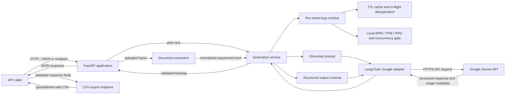
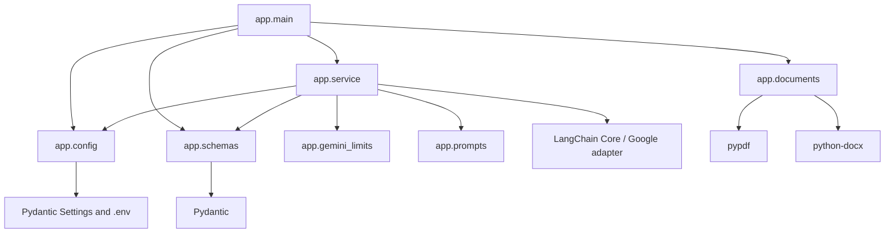
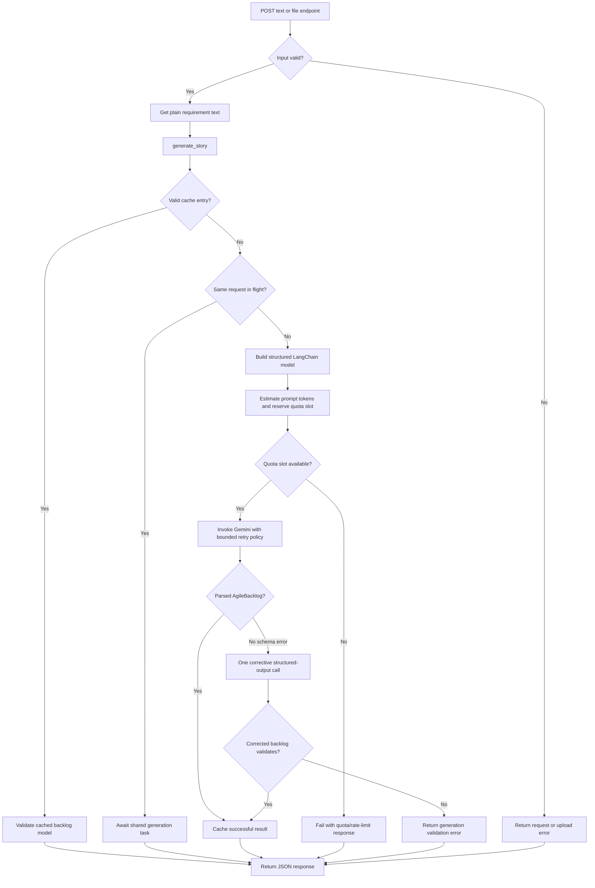
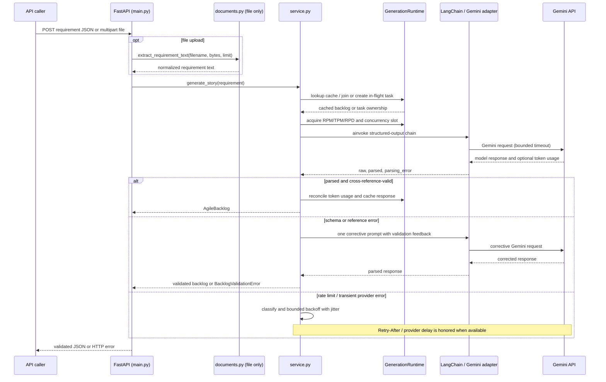
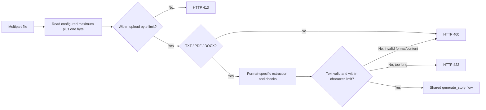
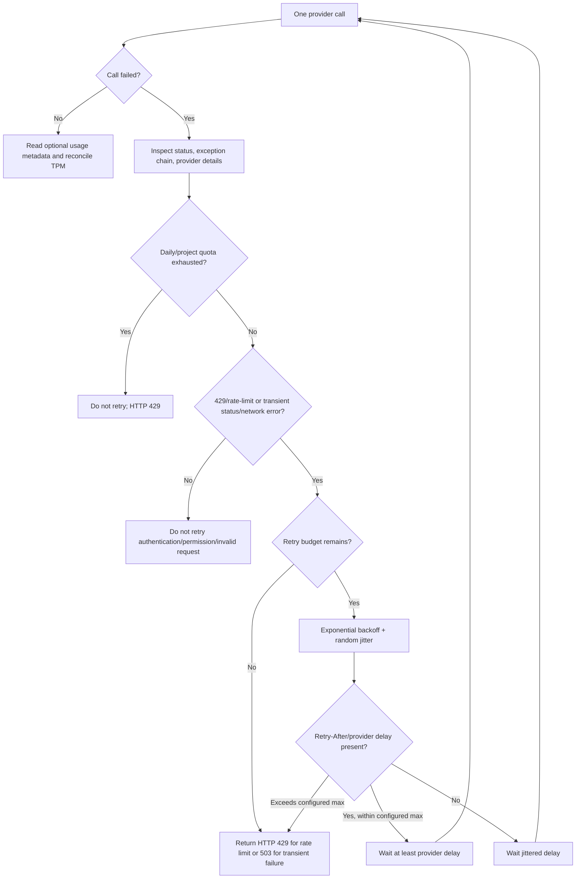

# Storyforge Backend: Technical Documentation

**Audience:** backend developers, maintainers, and technical reviewers  
**Scope:** current backend implementation and its externally visible API  
**Last verified:** 29 October 2026

> This document describes the code currently in the repository. It excludes frontend
> implementation details. Recommendations and limitations are identified separately from
> verified behavior.

## Table of contents

1. [Project overview](#1-project-overview)
2. [Repository structure](#2-repository-structure)
3. [Architecture](#3-architecture)
4. [Application startup and request flow](#4-application-startup-and-request-flow)
5. [Backend modules](#5-backend-modules)
6. [Core workflows](#6-core-workflows)
7. [Data contracts and persistence](#7-data-contracts-and-persistence)
8. [Integrations, configuration, and secrets](#8-integrations-configuration-and-secrets)
9. [Execution, testing, and deployment](#9-execution-testing-and-deployment)
10. [Technical observations](#10-technical-observations)
11. [Glossary](#11-glossary)

---

## 1. Project overview

Storyforge accepts a product requirement as plain text or as a `.txt`, `.pdf`, or `.docx`
file and asks Google Gemini to turn it into a structured Agile backlog. The backend returns
the source text together with a validated backlog containing a requirement summary, epics,
user stories, acceptance criteria, non-functional requirements, assumptions, open questions,
explicit exclusions, requirement coverage, and refinement recommendations. A separate API
endpoint exports that response as CSV.

### Architecture at a glance



The API boundary is FastAPI. Both text and file requests converge on the same generation
service; uploaded files are first converted into text. The service coordinates caching,
deduplication, local quota reservations, prompt/schema construction, provider retries, and
Pydantic validation. No database or durable job system appears in this architecture.

### Technology stack

| Area | Implementation |
|---|---|
| HTTP API and ASGI | FastAPI, Starlette responses/middleware, Uvicorn |
| Runtime and dependency management | Python 3.11+ and `uv` (`backend/pyproject.toml`, `backend/uv.lock`) |
| Request/response validation | Pydantic v2 and `pydantic-settings` |
| LLM orchestration | LangChain Core and `langchain-google-genai` |
| Model provider | Google Gemini through the Google GenAI SDK used by the LangChain adapter |
| Prompting | `ChatPromptTemplate` with a system message and a requirement-bearing human message |
| File parsing | `pypdf` for PDFs; `python-docx` for DOCX; Python UTF-8 decoding for TXT |
| CSV generation | Python standard-library `csv` module and FastAPI `StreamingResponse` |
| Tests and lint | pytest, FastAPI `TestClient`, Ruff |

The installed environment used for this documentation reported FastAPI 0.162.0,
LangChain Core 1.7.0, `langchain-google-genai` 4.4.2, Google GenAI 2.33.0, and Pydantic
2.14.1. The supported dependency ranges are declared in `backend/pyproject.toml`; the
environment-specific versions are not hard-coded as application behavior.

## 2. Repository structure

```text
.
├── .env.example
├── README.md
├── backend/
│   ├── app/
│   │   ├── __init__.py
│   │   ├── config.py
│   │   ├── documents.py
│   │   ├── gemini_limits.py
│   │   ├── main.py
│   │   ├── prompts.py
│   │   ├── schemas.py
│   │   └── service.py
│   ├── tests/
│   │   ├── test_api.py
│   │   └── test_gemini_limits.py
│   ├── pyproject.toml
│   └── uv.lock
├── docs/
│   ├── TECHNICAL_DOCUMENTATION.md
│   └── TECHNICAL_DOCUMENTATION.pdf
└── frontend/                 # API consumer; its implementation is outside this document
```

| Path | Responsibility |
|---|---|
| [`backend/app/main.py`](../backend/app/main.py) | Creates the FastAPI application, configures CORS and request-validation handling, defines health/generation/file/export endpoints, maps service errors to HTTP responses, and serializes CSV. |
| [`backend/app/config.py`](../backend/app/config.py) | Defines validated environment-backed settings and memoizes settings loading. |
| [`backend/app/documents.py`](../backend/app/documents.py) | Validates and extracts text from TXT, PDF, and DOCX uploads; enforces extracted-text limits. |
| [`backend/app/prompts.py`](../backend/app/prompts.py) | Defines the system and human instructions used to ground and structure backlog generation. |
| [`backend/app/schemas.py`](../backend/app/schemas.py) | Defines request and backlog data models, field constraints, allowed values, and cross-reference/sequence validation. |
| [`backend/app/service.py`](../backend/app/service.py) | Builds the LangChain model pipeline; implements per-loop runtime state, cache, request deduplication, retries, provider-error classification, token accounting, and structured-output correction. |
| [`backend/app/gemini_limits.py`](../backend/app/gemini_limits.py) | Implements process-local sliding-window request/token quotas, concurrency admission, and approximate token estimation. |
| [`backend/tests/test_api.py`](../backend/tests/test_api.py) | Tests endpoint contracts, validation, upload parsing, response/error mapping, CSV safety, and backlog relationships. |
| [`backend/tests/test_gemini_limits.py`](../backend/tests/test_gemini_limits.py) | Tests quotas, concurrency, retries, deduplication, and token-usage reconciliation. |
| [`backend/pyproject.toml`](../backend/pyproject.toml) | Declares Python support, runtime/development dependencies, pytest settings, and Ruff rules. |
| [`backend/uv.lock`](../backend/uv.lock) | Locks the resolved Python dependency graph for reproducible `uv` installation. |
| [`.env.example`](../.env.example) | Lists supported environment variable names and safe illustrative values. It is not a production secret store. |
| [`README.md`](../README.md) | Provides user-facing setup, API/Swagger instructions, and configuration overview. |

The root `frontend/` directory is present but is deliberately not described beyond its role
as an API consumer. Local `.venv`, `node_modules`, and build output are generated artifacts,
not backend source modules.

## 3. Architecture

### 3.1 Module dependency view



`main.py` is the HTTP composition layer. It delegates parsing, model work, and validation
to dedicated modules. The service depends on the schema and prompt but does not depend on
the FastAPI request object. This separation lets tests exercise service behaviors with
fake LangChain runnables and exercise endpoints through `TestClient`.

### 3.2 Runtime state and persistence boundaries

`service.py` associates a `GenerationRuntime` with each active asyncio event loop. That
runtime owns an in-memory cache, a map of in-flight generation tasks, and a
`GeminiRateLimiter`. The limiter itself tracks estimated/actual token reservations and call
timestamps for rolling one-minute and 24-hour windows.

This state is neither durable nor shared between Python processes. A process restart clears
it. Multiple workers or replicas independently count usage, so the configured local limits
are not a distributed quota guarantee. The application does not persist requirements,
backlogs, generated CSV files, or model history to a database or object store.

## 4. Application startup and request flow

### 4.1 Startup

1. Uvicorn imports `app.main:app`.
2. Importing `main.py` calls `get_settings()` once for application-level CORS configuration
   and upload handling. The settings accessor is cached with `lru_cache`.
3. `config.py` reads environment variables and the project-root `.env` file
   (`SettingsConfigDict` points two parent directories above `backend/app/config.py`).
4. FastAPI is constructed and CORS middleware and the JSON-validation exception handler are
   registered.
5. The first generation request creates the generation runtime for the active event loop;
   runtime state is reused for matching configuration on that loop.

There is no database connection pool, startup migration, scheduled task, or explicit
application lifespan hook in the current backend.

### 4.2 Generation flow



The diagram distinguishes client-side input rejection from model-generation errors. A
successful model response may still require a schema correction call; only successfully
validated backlogs are cached.

### 4.3 Critical request sequence



Each generation attempt consumes a local request reservation before the provider call.
Retries re-enter the gate, so they also count against configured local request and token
limits. The optional schema correction is a separate model invocation and has its own
bounded retries.

## 5. Backend modules

### 5.1 `app.main` — HTTP boundary and CSV export

The module constructs `FastAPI(title="Storyforge API")`, installs CORS using
`Settings.allowed_origins`, and registers a special `RequestValidationError` handler.
Malformed JSON receives a 422 response explaining that line breaks inside JSON strings
must be escaped as `\\n`; other Pydantic request errors use FastAPI's standard validation
response.

| Route / symbol | Input and output | Behavior |
|---|---|---|
| `GET /health` / `health()` | No input; `{"status": "ok"}` | Liveness only; it does not call Gemini or verify provider availability. |
| `POST /api/v1/stories/generate` / `create_story()` | `GenerateStoryRequest`; `GeneratedBacklogResponse` | Forwards the validated requirement string into `_generate_backlog_response()`. |
| `POST /api/v1/stories/generate-file` / `create_story_from_file()` | Multipart `UploadFile`; `GeneratedBacklogResponse` | Reads at most configured bytes plus one sentinel byte, closes the upload, extracts text, then uses the shared generation path. |
| `_generate_backlog_response()` | Requirement string; validated response | Calls `generate_story()` and maps configuration, quota, provider, parsing, and unexpected errors to HTTP status codes. |
| `POST /api/v1/stories/export` / `export_story()` | `ExportStoryRequest`; CSV attachment | Validates the supplied response, creates one flat row per logical backlog item, and returns CSV bytes. `?format=normalized` selects the legacy field/value layout. |

Error mapping in `_generate_backlog_response()` is explicit:

| Error class | HTTP status | Notes |
|---|---:|---|
| `GeminiConfigurationError` | 503 | Gemini API key is missing. |
| `GeminiQuotaExhaustedError`, `GeminiRateLimitError` | 429 | Includes `Retry-After` only when a provider delay is available. |
| `GeminiUnavailableError` | 503 | Bounded retries for transient/provider-unavailable errors were exhausted. |
| `GeminiProviderError` | 502 | Other provider rejections; a sanitized message is returned. |
| `BacklogValidationError` | 502 | Structured output remained invalid after correction, or was not parseable. |
| Other unexpected exception | 502 | Generic client detail; exception type is logged. |

CSV generation uses Python's `csv.writer`, `StringIO`, and `StreamingResponse`. Although
the response is streamed to the HTTP caller, the CSV is first built in memory. The default
flat export uses `FLAT_CSV_HEADERS`, with dedicated columns for common item data, source
and summary fields, epic/story/NFR details, relationships, and coverage/recommendations.
It emits one row per source requirement, summary, epic, user story, NFR, assumption, open
question, out-of-scope entry, coverage entry, and recommendation. Acceptance criteria
remain in their story row as readable multiline `Given:`, `When:`, and `Then:` blocks;
criteria do not create extra rows. Arrays use semicolon-separated values except story
assumptions and questions, which use line breaks for readability. Empty optional values
remain blank, and summary/source values are not repeated across item rows.

`format=normalized` retains the previous five-column `Section`, `Item ID`, `Related Item
IDs`, `Field`, and `Value` layout for callers that require it. Both formats are written
with standard CSV escaping, CRLF record endings, UTF-8 with a BOM, and formula-prefix
neutralization. `_spreadsheet_safe()` examines the first visible character after
whitespace, control characters, and BOMs, then prefixes an apostrophe for `=`, `+`, `-`,
or `@`. The default response filename is `agile-backlog.csv`; the normalized response is
`agile-backlog-normalized.csv`. Responses include `Cache-Control: no-store` and
`X-Content-Type-Options: nosniff`. CSV export does not call Gemini.

### 5.2 `app.config` — settings and environment

`Settings` uses Pydantic Settings to parse environment variables and the root `.env` file.
Numeric settings have Pydantic bounds; `allowed_origins` splits and trims the comma-separated
`CORS_ORIGINS` value. `get_settings()` is decorated with `@lru_cache`, so settings are loaded
once per process unless the cache is explicitly cleared in code.

Important lifecycle detail: `main.py` stores a module-level `settings` object at import time
for CORS and upload processing. Model-service settings are read through `get_settings()`
when generation starts. In normal operation both are the same cached settings object.

### 5.3 `app.documents` — extraction and upload validation

`extract_requirement_text(filename, content, max_chars)` uses the lowercase filename
extension as the format selector and accepts only `.txt`, `.pdf`, or `.docx`. It rejects
empty input and returns stripped, non-empty text with at least 10 characters.

| Format | Current handling | Important rejection cases |
|---|---|---|
| TXT | Rejects NUL bytes; decodes `utf-8-sig` (UTF-8 with optional BOM). | Unsupported extension, binary-looking NUL, invalid UTF-8, empty/too-short text. |
| PDF | Requires `%PDF-` prefix; reads with `PdfReader(strict=False)`; rejects encrypted documents; extracts each page's text and joins page text with blank lines. | Invalid PDF, encrypted PDF, extracted text above the limit, no extractable text (scanned/image-only content requires OCR elsewhere). |
| DOCX | Opens the ZIP container; caps entry count at 1,000 and aggregate uncompressed size at 30,000,000 bytes; checks expected DOCX entries; uses `python-docx` to gather non-empty paragraphs and table rows. | Invalid archive/structure, oversized expanded archive, unreadable document, extracted text above the configured limit. |

`RequirementTooLongError` is mapped to HTTP 422 by the file endpoint. Extraction failures
are mapped to HTTP 400. The request-byte ceiling is enforced separately by `main.py` before
document parsing.

### 5.4 `app.prompts` — grounding and backlog instructions

`STORY_PROMPT` is a `ChatPromptTemplate` with a system message and a human message containing
the `{requirement}` variable inside `<requirement>` tags. The system prompt instructs the
model to:

- Treat requirement content as untrusted data and the sole source of product facts.
- Inventory explicit requirements and assign internal traceability IDs.
- Produce only schema-supported backlog sections and allowed status/priority values.
- Decompose stories according to distinct user goals, not mechanically by sentence.
- Use observable Given/When/Then criteria and preserve unresolved business questions.
- Avoid invented behaviors, thresholds, permissions, integrations, and exclusions.
- Audit coverage, references, IDs, and consistency before returning structured output.

The requirement delimiters and system instructions are prompt-level grounding measures;
they are not a formal isolation boundary. The model's output is independently schema- and
reference-validated in `schemas.py`.

### 5.5 `app.schemas` — data contract and integrity checks

All public request and backlog types inherit from `StrictModel`, which rejects unknown
fields. `GenerateStoryRequest.requirement` is stripped, must contain 10–10,000 characters,
and includes a Swagger example. `AgileBacklog` groups the output into:

| Model | Main fields / purpose |
|---|---|
| `RequirementSummary` | Business objective, actors, capabilities, constraints/rules. |
| `Epic` | `epic_id`, title, description, business value, story membership. |
| `UserStory` | Story/epic IDs, persona, statement, acceptance criteria, priority, dependencies, refinement status, requirement references, assumptions, questions. |
| `AcceptanceCriterion` | One `given`, `when`, and `then` string. |
| `NonFunctionalRequirement` | NFR identifier, requirement, related backlog items, testability clarification. |
| `RequirementCoverage` | Requirement ID/type/wording, mapped items, coverage status, reason. |
| `OpenQuestion` | Stakeholder question and affected IDs. |
| `RefinementRecommendation` | Recommendation and related IDs. |
| `GeneratedBacklogResponse` | Original normalized requirement plus an `AgileBacklog`. |

`AgileBacklog.validate_backlog_references()` checks sequential IDs (`E1...`, `S1...`,
`NFR-001...`, `R-001...`), story-to-epic references, story requirement/dependency references,
NFR and coverage mappings, question/recommendation mappings, self-dependencies, and cycles
in the story-dependency graph. Because `Epic.related_story_ids` duplicates the canonical
`UserStory.epic_id` relationship, the validator rebuilds epic membership from story
`epic_id` values instead of trusting the model-generated duplicate list.

This validator checks structural consistency, not whether the generated backlog is
semantically complete or whether the model's coverage status is correct.

### 5.6 `app.service` — LLM orchestration

`generate_story(requirement)` is the entry point called by API handlers. It first verifies
that `GOOGLE_API_KEY` is configured, obtains the per-event-loop runtime, and computes a
SHA-256 key from the exact requirement, model name, prompt messages, and JSON schema. Under
the runtime lock, it returns an unexpired cached `AgileBacklog`, joins an identical
in-flight task, or starts one new `_generate_and_cache()` task. `asyncio.shield()` prevents
one canceled HTTP waiter from automatically canceling shared work.

`_generate_uncached()` constructs `ChatGoogleGenerativeAI` with temperature zero,
the configured output-token limit and timeout, and `max_retries=0`. Disabling the adapter's
internal retries leaves retry counting and quota accounting in the application policy.
`with_structured_output(AgileBacklog, method="json_schema", include_raw=True)` returns raw
message metadata alongside parsed output and any parsing error.

If structured parsing fails, the service makes one separate corrective invocation using
`VALIDATION_RETRY_PROMPT`, the original requirement, and the parser error text. That
correction is itself subject to the same quota and transient-retry controls. A second invalid
response raises `BacklogValidationError`; no invalid backlog is returned or cached.

`GenerationRuntime` owns its LRU-like `OrderedDict` cache, in-flight task map, asyncio lock,
and limiter. Cache expiry uses `time.monotonic()`. The key hashes requirement/model/prompt/
schema rather than storing those values in log messages; cache contents themselves remain
in process memory until eviction or expiry.

### 5.7 `app.gemini_limits` — local quota and concurrency gate

`GeminiRateLimiter.request_slot(estimated_tokens)` is an async context manager. It:

1. Rejects a single estimated request larger than configured TPM.
2. Acquires the concurrency semaphore.
3. Under an async lock, prunes usage older than 24 hours and checks rolling 60-second
   request/token windows and rolling 24-hour request count.
4. Reserves request and estimated-token usage if capacity is available.
5. Otherwise waits for the earliest applicable window to free capacity, bounded by
   `GEMINI_RATE_LIMIT_MAX_WAIT_SECONDS`, then retries admission.
6. Holds the semaphore while the provider operation runs, releasing it on success, error,
   or cancellation.

`record_actual_tokens()` replaces a reservation's estimated token count with Gemini usage
metadata when available. Failed calls remain counted using the reservation, which is
conservative for TPM accounting. `estimate_tokens()` approximates prompt input as
`ceil(character_count / 3)` plus the configured output-token reserve; it deliberately avoids
an additional remote token-count request.

The configured RPD value is enforced as a rolling 24-hour process-local window, not as a
provider calendar-day counter. Any configured cap should be lower than the real quota to
leave room for other callers and estimation error.

## 6. Core workflows

### 6.1 Plain-text backlog generation

1. FastAPI validates JSON against `GenerateStoryRequest` (unknown fields rejected,
   requirement length 10–10,000 characters).
2. `create_story()` passes the normalized string to `_generate_backlog_response()`.
3. `generate_story()` checks API-key configuration and cache/deduplication state.
4. `_generate_uncached()` builds the LangChain structured-output runnable from
   `STORY_PROMPT` and `AgileBacklog`.
5. `_invoke_with_retries()` estimates tokens, reserves a local quota/concurrency slot, and
   invokes the chain. Rate limits and transient failures receive bounded retries.
6. Pydantic parses and cross-validates the model output. An invalid structured response may
   trigger one corrective generation call.
7. The service caches only a valid backlog and returns it in `GeneratedBacklogResponse`.

### 6.2 File-based backlog generation



`create_story_from_file()` reads a maximum of configured byte limit plus one to detect
oversized uploads without reading the whole remaining stream. It closes the `UploadFile` in
a `finally` block. `extract_requirement_text()` normalizes format-specific content and then
the exact same service and response model used for plain text are used. Uploaded bytes are
not written to persistent storage by this code.

### 6.3 Retry and provider error handling



`service.py` walks the LangChain exception cause/context chain to find SDK status codes,
details, headers, and network error types. HTTP 429 may be retried unless its provider
details identify exhausted daily/project quota. HTTP 408 and selected 5xx statuses, plus
recognized transport failures/timeouts, are transient. HTTP 400/401/403/other 4xx are not
repeated as transient failures. `Retry-After` accepts seconds or an HTTP date; Google
`retryDelay` provider details are also inspected. The delay uses the greater of the
jittered exponential delay and provider delay; if provider delay exceeds the configured
retry maximum, the service fails instead of retrying early.

The retry count is per model invocation: initial output and optional corrective output are
separate invocations. With the default two retries, one initial request may issue at most
three provider attempts; if correction is needed, it can issue up to three more.

### 6.4 CSV export

The export endpoint accepts the full generation response shape and re-validates its nested
backlog. The default flat layout writes one row per logical item and maps the validated
schema fields to dedicated columns, preserving links among epics, stories, NFRs,
requirements, coverage, and recommendations. Acceptance criteria are kept together in the
story row as labeled multiline text; empty optional values stay blank. A UTF-8 BOM supports
Excel, and `csv.writer` handles commas, quotes, Unicode, and embedded newlines. Spreadsheet
formula-like values are neutralized, including when control characters or whitespace
precede the formula prefix. Callers can request `?format=normalized` for the prior
five-column field/value format. Export operates only on the supplied validated backlog and
does not call Gemini.

## 7. Data contracts and persistence

### API contract summary

| Method and path | Request | Success response | Notable errors |
|---|---|---|---|
| `GET /health` | None | `{"status":"ok"}` | No provider health check is performed. |
| `POST /api/v1/stories/generate` | JSON `{"requirement": "..."}` | `{"source_requirement": "...", "backlog": {...}}` | 422 for invalid request/JSON; 429 quota/rate limit; 502 invalid model/provider response; 503 missing key or transient provider outage. |
| `POST /api/v1/stories/generate-file` | Multipart field `file` | Same generation response shape | 400 unsupported/unreadable content; 413 upload exceeds byte limit; 422 extracted text too long or invalid request. |
| `POST /api/v1/stories/export` | Full response object (`source_requirement` and `backlog`); optional `format=flat|normalized` query | `text/csv; charset=utf-8` attachment; flat by default | 422 invalid payload/backlog references. |

File parsing errors are raised before provider generation. A multiline text JSON body must
escape embedded line breaks as `\\n`; malformed JSON is handled by the custom 422
validation handler.

### Persistence, queues, and external services

| Concern | Current implementation |
|---|---|
| Relational/document database | None present. |
| Durable requirement/backlog storage | None; API results are returned and not persisted. |
| Cache/deduplication | Bounded in-memory cache and in-flight task sharing per event loop/process. |
| Background queue/scheduler | None present. Model generation runs as part of the HTTP request. |
| File/object storage | None; upload bytes are read and parsed in memory, then the upload is closed. |
| Vector database / retrieval | None present; prompt grounding uses the supplied requirement, not retrieval. |
| OCR | None present; scanned PDFs without extractable text are rejected with an OCR guidance error. |
| External model API | Google Gemini, called through LangChain's Google integration. |
| Telemetry/metrics backend | No dedicated metrics exporter or tracing integration was found. Standard Python logging is used. |

The service is therefore request/response oriented. Large model latency occupies a request
worker and no asynchronous job/status API is defined.

## 8. Integrations, configuration, and secrets

### 8.1 Gemini integration

The application constructs `ChatGoogleGenerativeAI` with the configured model name, API key,
temperature `0`, configured timeout and output-token limit, and adapter retries disabled.
LangChain's `with_structured_output()` uses JSON Schema mode and the Pydantic
`AgileBacklog` model. The adapter sends requests to Google's service and returns
`AIMessage` usage metadata when the provider supplies it.

No separate direct Gemini client is created by application code; SDK error objects may be
available as causes of LangChain exceptions. The service inspects those causes rather than
logging raw provider bodies or the submitted requirement.

### 8.2 Environment variables

Settings and defaults below are taken from `Settings` in `config.py` and `.env.example`.
Quota caps of zero are disabled because provider quotas are project/model/tier-specific.

| Variable | Default | Meaning |
|---|---:|---|
| `GOOGLE_API_KEY` | empty | Required server-side Gemini credential. Never put this value in client requests or commit it. |
| `GEMINI_MODEL` | `gemini-3.8-flash` | Gemini model identifier. |
| `CORS_ORIGINS` | `http://localhost:5173,http://127.0.0.1:5173` | Comma-separated allowed browser origins. |
| `MAX_REQUIREMENT_CHARS` | `10000` | Text length ceiling; Pydantic caps the setting at 10,000. |
| `MAX_UPLOAD_BYTES` | `10485760` | Upload byte ceiling (10 MiB); Pydantic caps it at 25,000,000 bytes. |
| `GEMINI_REQUESTS_PER_MINUTE` | `0` | Optional local rolling-minute request cap. |
| `GEMINI_TOKENS_PER_MINUTE` | `0` | Optional local rolling-minute token cap using approximate preflight reservation and actual usage reconciliation. |
| `GEMINI_REQUESTS_PER_DAY` | `0` | Optional local rolling-24-hour request cap. |
| `GEMINI_MAX_CONCURRENCY` | `3` | Maximum provider calls in progress per process/event-loop runtime. |
| `GEMINI_RATE_LIMIT_MAX_WAIT_SECONDS` | `30` | Admission wait ceiling before local quota failure. |
| `GEMINI_MAX_RETRIES` | `2` | Retry count per provider invocation (0–5). |
| `GEMINI_RETRY_BASE_SECONDS` | `0.5` | Exponential retry base. |
| `GEMINI_RETRY_MAX_SECONDS` | `15` | Maximum local retry delay; longer provider-directed waits fail safely. |
| `GEMINI_TIMEOUT_SECONDS` | `45` | Provider call timeout. |
| `GEMINI_MAX_OUTPUT_TOKENS` | `8192` | Model output cap and reserved output-token budget for TPM admission. |
| `GENERATION_CACHE_TTL_SECONDS` | `300` | Successful result cache lifetime; zero disables TTL caching. |
| `GENERATION_CACHE_MAX_ENTRIES` | `256` | Maximum in-memory cached results; zero disables caching. |

`VITE_API_BASE_URL` is a client-side setting and is omitted from backend configuration
details. The root `.env.example` contains placeholders only. The actual `.env` is ignored by
Git according to `.gitignore`; supply real secrets through a protected local environment or
deployment secret manager.

The application currently has no end-user authentication/authorization layer. `GOOGLE_API_KEY`
authenticates the backend to Gemini; it does not authenticate API callers.

### 8.3 Logging and sensitive data

`service.py` logs cache hits, request completion latency, attempt count, model name,
provider status, exception type, retry delay, and token usage where available. It does not
include requirement text or API keys in those structured extras. `main.py` logs sanitized
generation error types and status. Logging uses standard Python `logging`; the repository
does not configure JSON formatting, log aggregation, retention, or alerting.

## 9. Execution, testing, and deployment

### 9.1 Local backend setup

From the repository root, copy `.env.example` to `.env` and set `GOOGLE_API_KEY` in the
local `.env`. Then run:

```sh
cd backend
uv sync
uv run uvicorn app.main:app --reload
```

The backend listens on Uvicorn's default local host/port unless the command is changed.
Interactive OpenAPI documentation is available at `/docs`, ReDoc at `/redoc`, and the
liveness endpoint at `/health`.

To run tests and lint:

```sh
cd backend
uv run pytest
uv run ruff check app tests
uv run ruff format --check app tests
```

### 9.2 Test strategy

`test_api.py` uses FastAPI `TestClient` and monkeypatches the generator at the API boundary
for endpoint tests. It covers health, OpenAPI shape, CORS preflight, valid generation,
malformed multiline JSON, request-length validation, provider status mapping, CSV export and
formula neutralization, backlog cross-references, and TXT/PDF/DOCX parsing and rejection.

`test_gemini_limits.py` tests the local RPM/RPD/TPM controls, concurrency admission, retry
after a 429 with `Retry-After`, no-retry failures for auth/invalid/daily quota, bounded retry
counts for 429 and 503, usage reconciliation, and single-flight/cache behavior. Tests use
fake provider responses and do not require a live Gemini key or network request.

### 9.3 Deployment and operational implementation present

The repository contains no Dockerfile, Compose file, Kubernetes manifest, cloud deployment
configuration, CI workflow, migration, or deployment automation in the inspected project
files. The documented launch path is Uvicorn with `uv`. Production deployment choices
(worker count, process manager, TLS termination, secrets manager, health/readiness probes,
and centralized logging) are not prescribed in the current source.

Because quotas and cache state are process-local, deploying multiple workers changes the
effective aggregate concurrency and request rate. A shared limiter/cache or conservative
per-worker allocation is needed if the Google project quota is shared among replicas.

## 10. Technical observations

The points below distinguish behavior observed in code from recommendations. They do not
claim that the application is defective; they identify boundaries a maintainer should
understand before production scaling.

### Verified design decisions and strengths

- **Separation by concern:** HTTP handling, parsing, prompt/schema contracts, Gemini
  orchestration, and rate limiting have distinct modules.
- **Structured output:** Gemini results are parsed into Pydantic types and cross-reference
  checks run before the API returns a backlog.
- **Bounded provider work:** Provider timeout, retry count, output cap, local concurrency,
  optional request/token quotas, and cache size/TTL are configurable and bounded.
- **No automatic retry for permanent errors:** authentication, permission, and invalid
  request classes are separated from transient failures; detected exhausted quota does not
  consume retries.
- **Document resource checks:** upload byte size, extracted text size, PDF encryption, DOCX
  expanded size, and DOCX entry count are checked.
- **CSV formula neutralization:** user/model-generated strings with spreadsheet formula
  prefixes are neutralized before export.
- **No model requirement persistence:** the service keeps results only in process memory
  for configured cache TTL; there is no durable application database.

### Operational and maintenance considerations

| Finding | Evidence / implication | Recommendation |
|---|---|---|
| Quota state is local to one process/event loop. | `GenerationRuntime` and limiter state are held in a `WeakKeyDictionary` keyed by event loop; no shared storage is configured. | Before horizontal scaling, use a shared quota coordinator or allocate a safe per-replica share of actual provider quotas. |
| TPM reservation is approximate. | Character-count heuristic (`ceil(chars / 3)`) plus output reserve is not provider tokenization. | Set TPM caps with estimation margin and observe real usage logs; consider provider-side quota limits as the final enforcement layer. |
| A schema correction is another full model invocation. | Initial generation and correction are separate calls, each with a retry budget. | Monitor correction frequency and prompt/output tokens; improve schema/prompt precision if corrections are frequent. |
| Caching and single-flight state are volatile. | State is in memory and expires/evicts; process restart loses it. | Treat it as an optimization, not durable idempotency or audit history. |
| The rate limiter's RPD is rolling 24 hours. | It prunes usage by age, not by provider quota calendar boundary. | Configure below the provider's limit and avoid treating this local cap as an exact replica of Google's quota accounting. |
| No caller authentication or API-level rate limiting is present. | CORS is configured, but CORS is not authentication; app-level quota gate applies to Gemini calls only. | Add caller identity, authorization, and edge/API throttling before exposing the service to untrusted networks. |
| No dedicated metrics/tracing/health readiness integration exists. | Logging is standard-library based; `/health` is liveness only. | Add operational telemetry and a separate readiness check if deployment requires provider/config dependency checks. |
| CSV is assembled in memory before returning. | `StringIO` content is encoded into `BytesIO`. | For unusually large generated payloads, assess memory limits; normal backlog sizes are bounded indirectly by model output configuration. |
| PDF extraction is text-based only. | `pypdf` extraction returns no text for image-only scans and requests OCR externally. | Introduce an explicit OCR integration only if scanned requirements become a supported product need. |
| Prompt-only grounding is not retrieval. | No vector database, search index, or external business knowledge source exists. | Keep claims strictly grounded in request input unless a separately governed knowledge integration is designed. |

### Not implemented / not evidenced

No database, vector store, durable cache, task queue, OCR service, external file storage,
end-user authentication, metrics exporter, tracing SDK, CI/CD workflow, or container/deploy
manifest was found in the backend/project files examined for this document. Do not infer
these capabilities from the API's “enterprise” description or the presence of configurable
rate limits.

## 11. Glossary

| Term | Meaning in this application |
|---|---|
| Agile backlog | The structured response containing summary, epics, stories, quality requirements, questions, coverage, and recommendations. |
| Coverage ID | Generated `R-001`-style identifier used to connect generated backlog items to a source requirement entry. It is not a quotation or identifier from the source document. |
| Structured output | Gemini response constrained and parsed against the Pydantic `AgileBacklog` schema. |
| Corrective generation | One additional LLM invocation after structured parsing or schema/reference validation fails. |
| Single-flight deduplication | Concurrent identical requests await the same in-process generation task. |
| Local quota | An optional in-process approximation of provider request/token limits; it is not Google's authoritative quota enforcement. |
| NFR | Non-functional requirement, such as a stated performance, reliability, or security quality expectation. |

---

## Source references

The links below point to the implementation described above:

- [API app and endpoint definitions](../backend/app/main.py#L30)
- [Settings and environment loading](../backend/app/config.py#L8)
- [Document extraction](../backend/app/documents.py#L17)
- [Grounding prompt](../backend/app/prompts.py#L3)
- [Backlog schemas and consistency validation](../backend/app/schemas.py#L10)
- [Generation runtime, caching, and LLM calls](../backend/app/service.py#L86)
- [Retry and provider-error classification](../backend/app/service.py#L270)
- [Local quotas and token estimation](../backend/app/gemini_limits.py#L20)
- [Backend tests](../backend/tests/test_api.py) and [rate-limit tests](../backend/tests/test_gemini_limits.py)
- [Dependency and tool configuration](../backend/pyproject.toml)
